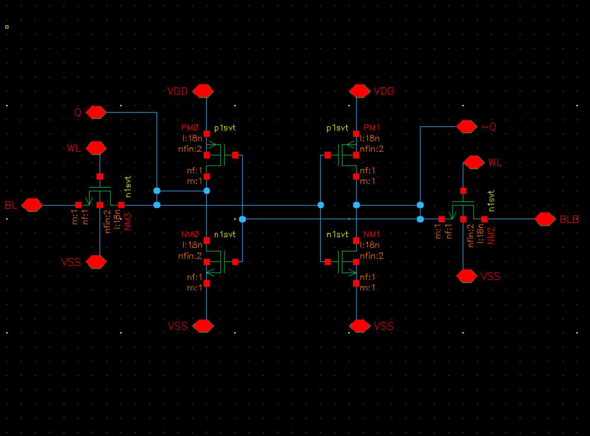

# SRAM-Based 4-bit MAC Accelerator — ESE 5700 (MSE EE, UPenn)

[](https://github.com/tmarhguy/mac-unit/actions/workflows/docs.yml)
[](https://github.com/tmarhguy/mac-unit/actions/workflows/latex-to-pdf.yml)
[](https://github.com/tmarhguy/mac-unit)
[](https://github.com/tmarhguy/mac-unit)
[](https://github.com/tmarhguy/mac-unit)
[](https://github.com/tmarhguy/mac-unit)
[](https://github.com/tmarhguy/mac-unit)

<p align="center">
  
  <br>
  <em>The actual design — 6T SRAM bitcell schematic (`proj1_lib` 6t-sram) in Virtuoso.</em>
</p>

<p align="center">
  <a href="https://github.com/tmarhguy"></a>
  <a href="https://github.com/vwanjohi"></a>
  <a href="https://tmarhguy.github.io/mac-unit/"></a>
</p>

**ESE 5700 — Digital Integrated Circuits and VLSI Fundamentals** (University of Pennsylvania). Project 1 develops a 6T SRAM bitcell for a later SRAM-based 4-bit multiply-accumulate (MAC) accelerator in the **Cadence GPDK 18 nm** Virtuoso / Spectre flow. Nominal $V_{DD}=0.8\,\mathrm{V}$.

**This GitHub repository is not the official Gradescope submission.** It is a shared archive for LaTeX sources, figures, and CI-built PDFs. Each part is uploaded separately to Gradescope as one team PDF.

**Current course handout (in-repo):** [docs/ese5700-project1.pdf](docs/ese5700-project1.pdf). Its requirements and dates supersede earlier drafts.

## Docs

- [Report site](https://tmarhguy.github.io/mac-unit/) — the running
  report, built from [`docs/index.adoc`](docs/index.adoc) with `make docs`
- [Full Part 1 PDF](ESE5700_Proj1_Part1.pdf) and [LaTeX source](ESE5700_Proj1_Part1.tex)
- [Raw read-SNM sweep and measured results](results/part1/read-snm/)
- [architecture](docs/architecture.md) — design and build order
- [ADRs](docs/adr/) — sizing and signoff decisions

## Team

| Member | Role |
|--------|------|
| **Tyrone Marhguy** | Co-author |
| **Victor Wanjohi** | Co-author |

This is a **two-person team**. Each Gradescope report lists both members and delineates contributions. Both teammates are responsible for understanding the full design and report for every part.

## Project overview

The unit computes a 16-element dot product of 4-bit unsigned weights and activations:

$$
\mathrm{ACC} = \sum_{i=0}^{15} W[i] \cdot X[i]
$$

using two **16 × 4** SRAM macros, a 4×4 multiplier, a 12-bit accumulator, and a sequencer. The maximum unsigned sum is $16 \times 15 \times 15 = 3600$, which fits in 12 bits. The course splits the work into three graded parts; **this repository currently documents Part 1 work, not a completed MAC**.

| Part | Deliverable | Due | In repo |
|------|-------------|-----|---------|
| **1** | 6T SRAM bitcell: schematic, custom layout, post-layout stability | **10/13/2026** | Schematic and read-SNM sweep measured; layout signoff and post-layout work open |
| **2** | Bitcell tiled into a 16 × 4 synchronous SRAM macro | **10/20/2026** | later |
| **3** | Two SRAMs + datapath + sequencer → MAC unit | **10/27/2026** | later |

Technology: **Cadence GPDK 18 nm** process, Virtuoso schematic/layout, Spectre/ADE, DRC/LVS/PEX. Nominal $V_{DD} = 0.8\,\mathrm{V}$. The handout also asks for Part 1 supply measurements at 0.7 V and 0.5 V; those are not yet reported results.

## Part 1 read-stability results

The repository contains the symmetric bitcell schematic, handwritten read and write analysis, Cadence testbench captures, and original ViVA butterfly screenshots. A three-point schematic pull-down ratio ($\beta$) sweep gives:

| $\beta$ | PD / PG / PU fins | Read SNM at 0.8 V | Read-disturbed zero node |
|---:|---:|---:|---:|
| 1.0 | 2 / 2 / 2 | 126.6 mV | 134.3 mV |
| 1.5 | 3 / 2 / 2 | 145.8 mV | 96.6 mV |
| **2.0** | **4 / 2 / 2** | **156.3 mV** | **77.1 mV** |

$\beta=2$, $\gamma=1$ is the **schematic candidate**. Its read SNM is 29.7 mV higher than the $\beta=1$ case. These values are not post-layout results. The handout still requires a tileable layout and area, DRC/LVS, extracted BL/WL capacitances, post-layout hold/read SNM, write margin and cell current, a supply table, and functional waveforms. The [report](ESE5700_Proj1_Part1.pdf) separates that open work from completed measurements.

## Repository layout

| Path | Description |
|------|-------------|
| [ESE5700_Proj1_Part1.tex](ESE5700_Proj1_Part1.tex) | Joint team Part 1 report source |
| [ESE5700_Proj1_Part1.pdf](ESE5700_Proj1_Part1.pdf) | CI-built PDF (after the workflow runs) |
| [docs/ese5700-project1.pdf](docs/ese5700-project1.pdf) | Current project handout |
| [media/part1/](media/part1/) | Schematic, handwritten analysis, testbench, and Cadence butterfly images |
| [results/part1/read-snm/](results/part1/read-snm/) | Raw CSVs, normalized curves, computed SNM, and plots |
| [scripts/](scripts/) | SNM analysis, TeX container, and docs build/validation tools |
| [.github/workflows/](.github/workflows/) | LaTeX → PDF + Docs (GitHub Pages) workflows |
| [docs/index.adoc](docs/index.adoc) | Technical manual source (Asciidoctor book) |

## Build the manual locally

Requirements: Asciidoctor (`brew install asciidoctor`), or `apt-get install asciidoctor` on Linux. No npm needed.

```bash
make docs
make docs-check  # validate links, figures, and reusable template
make docs-open   # serve build/docs on :8000
```

## Build the report locally

Requirements: `tectonic` or a modern TeX distribution with `latexmk`, or Docker/Podman for the containerized helper. The `make report` target selects an available method.

Native build:

```bash
latexmk -pdf -file-line-error -halt-on-error -interaction=nonstopmode ESE5700_Proj1_Part1.tex
```

Containerized build matching CI:

```bash
./scripts/run-latex-ci-local.sh
```

## Continuous Integration

The [LaTeX to PDF](.github/workflows/latex-to-pdf.yml) workflow runs on matching pushes to `main`/`master` or manual dispatch. It compiles Part 1 and commits a changed PDF with `[skip ci]`. The [Docs](.github/workflows/docs.yml) workflow builds and validates the website on matching pushes to any branch, and deploys from `contribution-tmarhguy` or `main`.

Manual runs: **Actions → LaTeX to PDF → Run workflow**. The currently tracked [PDF](ESE5700_Proj1_Part1.pdf) can also be built locally with `make report`.

## Academic integrity

This work is completed under the **University of Pennsylvania Code of Academic Integrity**. The repository archives our own materials and is not a substitute for Gradescope submission.

## Contact

**Victor Wanjohi**

[](mailto:vwanjohi@engineering.upenn.edu)
[](https://www.linkedin.com/in/victorwanjohi1/)

**Tyrone Marhguy**

[](mailto:tmarhguy@engineering.upenn.edu)
[](https://www.linkedin.com/in/tmarhguy/)
