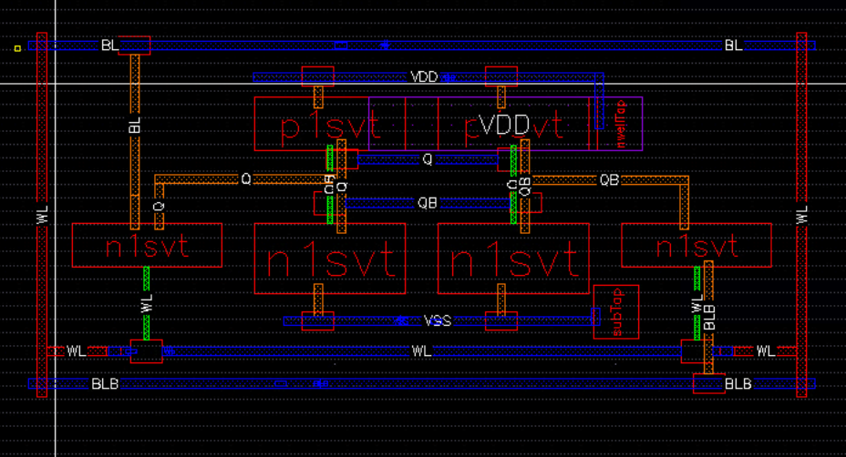
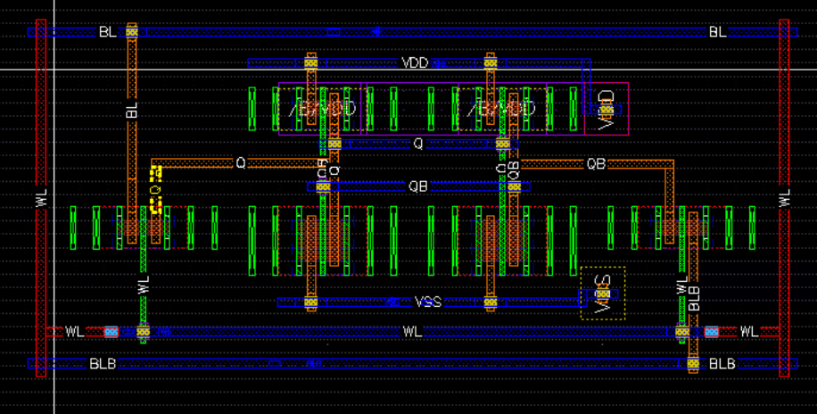
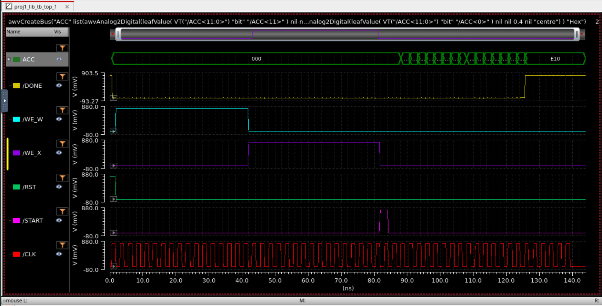

# SRAM-Based 4-bit MAC Accelerator — ESE 5700 (MSE EE, UPenn)

[](https://github.com/tmarhguy/mac-unit/actions/workflows/docs.yml)
[](https://github.com/tmarhguy/mac-unit/actions/workflows/latex-to-pdf.yml)
[](https://github.com/tmarhguy/mac-unit)
[](https://github.com/tmarhguy/mac-unit)
[](https://github.com/tmarhguy/mac-unit)
[](https://github.com/tmarhguy/mac-unit)
[](https://github.com/tmarhguy/mac-unit)

<p align="center">
  
  <br>
  
  
  <br>
  <em>Part 1 6T cell: schematic and layout (DRC 0, LVS match), Cadence GPDK 18 nm.</em>
</p>

<p align="center">
  <a href="https://github.com/tmarhguy"></a>
  <a href="https://github.com/vwanjohi"></a>
  <a href="https://tmarhguy.github.io/mac-unit/"></a>
</p>

**ESE 5700 — Digital Integrated Circuits and VLSI Fundamentals** (University of Pennsylvania). Project 1 is a 6T SRAM bitcell, a 16×4 SRAM macro, and an SRAM-based 4-bit multiply-accumulate (MAC) unit in the **Cadence GPDK 18 nm** Virtuoso / Spectre flow. Nominal $V_{DD}=0.8\,\mathrm{V}$. Schematic-level simulations (no extracted parasitics on the MAC).

**This GitHub repository is not the official Gradescope submission.** It is a shared archive for LaTeX sources, figures, and CI-built PDFs. Each part is uploaded separately to Gradescope as one team PDF.

**Current course handout (in-repo):** [docs/ese5700-project1.pdf](docs/ese5700-project1.pdf). Its requirements and dates supersede earlier drafts.

## Docs

- [Report site](https://tmarhguy.github.io/mac-unit/) — built from [`docs/index.adoc`](docs/index.adoc) with `make docs`
- [Part 1 PDF](report/part1/ESE5700_Proj1_Part1.pdf) · [source](report/part1/ESE5700_Proj1_Part1.tex)
- [Part 2 PDF](report/part2/ESE5700_Proj1_Part2.pdf) · [source](report/part2/ESE5700_Proj1_Part2.tex)
- [Part 3 PDF](report/part3/ESE5700_Proj1_Part3.pdf) · [source](report/part3/ESE5700_Proj1_Part3.tex) · [figures](report/part3/img/)
- [Raw read-SNM sweep](results/part1/read-snm/)
- [architecture](docs/architecture.md) — design and build order
- [ADRs](docs/adr/) — sizing and signoff decisions

## Team

| Member | Role |
|--------|------|
| **Tyrone Marhguy** | Co-author |
| **Victor Wanjohi** | Co-author |

This is a **two-person team**. Each Gradescope report lists both members and delineates contributions. Both teammates are responsible for understanding the full design and report for every part.

## Project overview

The unit computes a 16-element dot product of 4-bit unsigned weights and activations:

$$
\mathrm{ACC} = \sum_{i=0}^{15} W[i] \cdot X[i]
$$

using two **16 × 4** SRAM macros, a 4×4 array multiplier, a 12-bit ripple accumulator, and a 4-bit counter + FSM sequencer. All registers are transmission-gate master-slave flip-flops. The maximum unsigned sum is $16 \times 15 \times 15 = 3600$, which fits in 12 bits. A pipelined read / MAC takes **17 cycles** from START to DONE (limit: 20).

| Part | Deliverable | Due | In repo |
|------|-------------|-----|---------|
| **1** | 6T SRAM bitcell: schematic, custom layout, post-layout stability | 10/13/2026 | Cell 0.39 µm², DRC 0, LVS clean; extracted read SNM 140 mV at 0.8 V |
| **2** | Cell tiled into a 16 × 4 synchronous SRAM macro | 10/20/2026 | $T_{CLK}=0.69$ ns, $t_{\mathrm{access}}=488$ ps, area 54.6 µm² (est.), FOM $\approx 4.7\times10^{3}$ |
| **3** | Two macros + datapath + sequencer → MAC | 10/27/2026 | $T_{CLK}=2.5$ ns (400 MHz), $t_{dot}=42.5$ ns, Test A $E_{dot}=8.870$ pJ, FOM$_{MAC}=1.1\times10^{5}$ |

Technology: **Cadence GPDK 18 nm**, Virtuoso schematic/layout, Spectre/ADE/ViVA, DRC/LVS/PEX. Nominal $V_{DD} = 0.8\,\mathrm{V}$. Cadence libraries stay on the cluster (`proj1_lib`); this repo keeps reports, figures, and scripts.

## Part 3 MAC (selected operating point)

Selected clock is the shortest tested period where Tests A, B and C all pass. Test B (full-scale $15\times15$) fails at 2.0 ns (ACC $=0$xC10 instead of $0$xE10). Energy and FOM use the same 2.5 ns window.

| Metric | Value |
|--------|--------|
| $V_{DD}$ | 0.8 V |
| $T_{CLK}$ | **2.5 ns** (400 MHz) |
| Cycles START → DONE | 17 |
| $t_{dot}$ | **42.5 ns** |
| Area (2 macros + datapath + sequencer, $D=28$) | 291.8 µm² (est.) |
| Test A $E_{dot}$ (measured, VDD pin) | **8.870 pJ** (0.554 pJ/MAC) |
| Test B / C $E_{dot}$ | 15.29 pJ / 9.500 pJ |
| FOM$_{MAC}$ = Area · $E_{dot}$ · $t_{dot}$ | **$1.1\times10^{5}$** µm²·pJ·ns |

<p align="center">
  
  <br>
  <em>Test B at $T=2.5$ ns: ACC settles at 0xE10, DONE high near 126 ns.</em>
</p>

Sweep (Spectre `.vec` files in `stimuli/timing/` on the cluster, named `mac_top_<A\|B\|C>_<period>.vec`):

| $T_{CLK}$ | A (0x34D) | B (0xE10) | C (0x320) |
|-----------|-----------|-----------|-----------|
| 10 ns | pass | pass | pass |
| 4.0 ns | pass | pass | pass |
| **2.5 ns** | **pass** | **pass** | **pass** |
| 2.0 ns | pass | fail (0xC10) | pass |
| 1.75 ns | fail (0x31D) | fail | fail |
| 1.5 ns | fail (0x13D) | fail | fail |

Register (`d_ff`): $t_{cq}$ 68.51 / 62.18 ps, $t_{su}=40$ ps, $t_{h}=10/\le0$ ps, $C_{CLK}=2.822$ fF, energy 3.895 fJ idle / 9.309 fJ toggling. Multiplier: 256/256 correct, worst case $\approx1.2$ ns.

Figures for schematics, benches, DFF characterization, timing, and energy live in [report/part3/img/](report/part3/img/).

## Part 1 read-stability results

The repository contains the symmetric bitcell schematic, handwritten read and write analysis, Cadence testbench captures, and original ViVA butterfly screenshots. A three-point schematic pull-down ratio ($\beta$) sweep gives:

| $\beta$ | PD / PG / PU fins | Read SNM at 0.8 V | Read-disturbed zero node |
|---:|---:|---:|---:|
| 1.0 | 2 / 2 / 2 | 126.6 mV | 134.3 mV |
| 1.5 | 3 / 2 / 2 | 145.8 mV | 96.6 mV |
| **2.0** | **4 / 2 / 2** | **156.3 mV** | **77.1 mV** |

$\beta=2$, $\gamma=1$ is the selected sizing. Its schematic read SNM is 29.7 mV higher than the $\beta=1$ case. The [Part 1 report](report/part1/ESE5700_Proj1_Part1.pdf) uses the extracted cell: 0.72 µm × 0.54 µm, $D=28$, $C_{BL}=180$ aF, $C_{WL}=90$ aF, hold SNM 280 mV, read SNM 140 mV, disturbed zero node 95 mV, $\mathrm{WM}_{BL}=0.42$ V, and $I_{\mathrm{cell}}=25$ µA at 0.8 V. DRC is 0 violations and LVS is clean. At 0.7 V, read SNM is 110 mV and $\mathrm{WM}_{BL}$ is 0.32 V; at 0.5 V, read SNM is 70 mV and $\mathrm{WM}_{BL}$ is 0.18 V.

## Repository layout

| Path | Description |
|------|-------------|
| [report/part1/](report/part1/) | Part 1 report (`ESE5700_Proj1_Part1.tex`, PDF) |
| [report/part2/](report/part2/) | Part 2 report (`ESE5700_Proj1_Part2.tex`, PDF, `img/`) |
| [report/part3/](report/part3/) | Part 3 report (`ESE5700_Proj1_Part3.tex`, PDF) |
| [report/part3/img/](report/part3/img/) | Part 3 Cadence schematics, benches, timing and energy captures |
| [docs/ese5700-project1.pdf](docs/ese5700-project1.pdf) | Current project handout |
| [media/part1/](media/part1/) | Part 1 schematic, layout, testbench, and butterfly images |
| [results/part1/read-snm/](results/part1/read-snm/) | Raw CSVs, normalized curves, computed SNM, and plots |
| [scripts/](scripts/) | SNM analysis, TeX container, and docs build/validation tools |
| [.github/workflows/](.github/workflows/) | LaTeX → PDF + Docs (GitHub Pages) workflows |
| [docs/index.adoc](docs/index.adoc) | Technical manual source (Asciidoctor book) |

## Build the manual locally

Requirements: Asciidoctor (`brew install asciidoctor`), or `apt-get install asciidoctor` on Linux. No npm needed.

```bash
make docs
make docs-check  # validate links, figures, and reusable template
make docs-open   # serve build/docs on :8000
```

## Build the reports locally

Requirements: `tectonic` or a modern TeX distribution with `latexmk`. `make report` still compiles Part 1.

```bash
# Part 1
make report
# or: cd report/part1 && tectonic ESE5700_Proj1_Part1.tex

# Part 2
cd report/part2 && tectonic ESE5700_Proj1_Part2.tex

# Part 3 (figures are in report/part3/img/)
cd report/part3 && tectonic ESE5700_Proj1_Part3.tex
```

Containerized Part 1 build matching CI: `./scripts/run-latex-ci-local.sh`.

## Continuous Integration

The [LaTeX to PDF](.github/workflows/latex-to-pdf.yml) workflow runs on matching pushes to `main`/`master` or manual dispatch. It compiles **Part 1** and commits a changed PDF with `[skip ci]`. Parts 2 and 3 are compiled locally (`tectonic` in `report/part2/` and `report/part3/`). The [Docs](.github/workflows/docs.yml) workflow builds and validates the website on matching pushes to any branch, and deploys from `contribution-tmarhguy` or `main`.

Manual Part 1 runs: **Actions → LaTeX to PDF → Run workflow**.

## Academic integrity

This work is completed under the **University of Pennsylvania Code of Academic Integrity**. The repository archives our own materials and is not a substitute for Gradescope submission.

## Contact

**Victor Wanjohi**

[](mailto:vwanjohi@engineering.upenn.edu)
[](https://www.linkedin.com/in/victorwanjohi1/)

**Tyrone Marhguy**

[](mailto:tmarhguy@engineering.upenn.edu)
[](https://www.linkedin.com/in/tmarhguy/)
