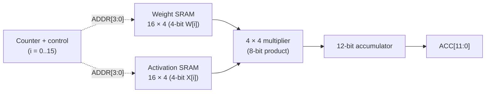

# MAC Unit Architecture

Source of truth for the system design; the full requirements live in
the course handout (`docs/ese5700-project1.pdf`). This document tracks
what exists today and what each part adds.

## Current state

**Part 1 — 6T bitcell (due 10/13/2026).**
Sizing (beta/gamma), custom layout, PEX loads, post-layout SNM / WM /
I_cell, functional transient. Report source:
`ESE5700_Proj1_Part1.tex`. Figures land in `media/part1/`.
Canonical schematic β sweep: `results/part1/read-snm/beta{1,1p5,2}/` (raw → q/qb → snm.json → butterfly.png/.svg via `scripts/check_snm_sweep.py`). Measured read-SNM at 0.8V: β1 126.6mV, β1.5 145.8mV, β2 156.3mV (selected β=2, γ=1).

**Part 2 — 16 × 4 SRAM macro (due 10/20/2026, roadmap).**
Part 1 cell tiled with WL horizontal / BL vertical, plus decoder,
precharge, sense/write periphery. Per-cell `C_BL` / `C_WL` from Part 1
scale to full-line loads.

**Part 3 — MAC unit (due 10/27/2026, roadmap).**
Two macros + 4×4 multiplier + 12-bit accumulator + sequencer
computing `ACC = sum W[i]*X[i]` over 16 positions.

## Block map

| Block | Owns | Part |
|---|---|---|
| 6T bitcell | PD/PU/PG sizing, SNM, WM, layout, PEX | 1 |
| 16 × 4 macro | tiling, decoder, precharge, sense, timing | 2 |
| multiplier | 4×4 unsigned products | 3 |
| accumulator | 12-bit sum (max 3600 < 4096) | 3 |
| sequencer | 16-step control FSM | 3 |

## Non-negotiables

- Post-layout numbers only in results; schematic-only stays in design.
- DRC and LVS clean at every level before signoff.
- Unmeasured values are `TBD`.
- Gradescope PDFs are canonical for grading; this repo archives sources.
