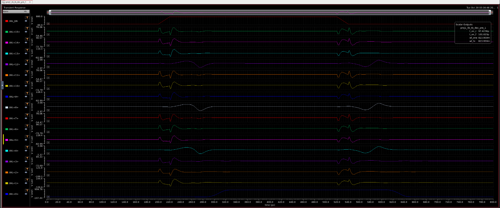

# decoder_predec unit test (4-to-16 row decoder with WL_EN)

Testbench `proj1_lib/tb_dec_pre`: transient 0 to 0.8 ns, nominal corner, 27 C, VDD = 0.8 V. `cwl` = 0.5 fF on each of the 16 wordlines (Part 1 gives 4 x 90 aF = 360 aF per row, plus wire). WL_EN: pulse 0 to 0.8 V, delay 200 ps, 20 ps edges, width 300 ps, period 1 ns. Address inputs are DC sources set by `a0` to `a3` (volts) with complements 0.8 - a. Schematics: `media/decoder_predec/`.

Design: PA<j> = WL_EN and (A<1:0> = j) through `nand3_u` + `inv_2x`; PB<m> = (A<3:2> = m) through `nand2_u` + `inv_2x`; `row_pre` (`nand2_u` + `inv_drv`) per row, WL<4m + j> = PA<j> and PB<m>. Path WL_EN to WL: `nand3_u`, `inv_2x`, `nand2_u`, `inv_drv`.

Output definitions use the sum of all 16 wordlines as "the selected wordline" (only one should be high):
- `t_en_r` / `t_en_f`: sum crossing 0.4 V (rising / falling) minus WL_EN crossing 0.4 V (rising / falling).
- `wl_one` = ymax(sum), spec < 1 V (two rows high would give about 1.6 V).
- `wl_hi` = ymax(sum), spec > 0.72 V (the selected row reaches high).

## Results so far: address 0 only (a0 = a1 = a2 = a3 = 0)

| Output | Value | Spec | Result |
|---|---|---|---|
| t_en_r | 97.42 ps | none | n/a |
| t_en_f | 101 ps | none | n/a |
| wl_one | 824 mV | < 1 V | pass |
| wl_hi | 824 mV | > 0.72 V | pass |

Headline at address 0: WL_EN to WL is about 97 ps rising and 101 ps falling (two significant figures). The 824 mV peak is 24 mV above VDD, an overshoot on the selected wordline (the sum of the other 15 rows is near 0).

Source: `media/decoder_predec/tb_dec_pre_ade_results_addr0.png`.

## Waveform at address 0

Caption: WL_EN and WL<15:0> for address 0 (nominal, `cwl` = 0.5 fF). Only WL<0> rises (about 300 ps, 97 ps after WL_EN crosses 0.4 V) and falls (about 620 ps after WL_EN falls at 520 ps). The other 15 rows stay at 0 V with only small coupling glitches: tens to about 150 uV on twelve rows and about 2 mV on WL<4>, WL<8> and WL<12>. Those three share PA<0> with WL<0> (rows 4m + 0), which is the expected place for a glitch. Scalar outputs on the plot: `t_en_r` 97.42 ps, `t_en_f` 101.02 ps, `wl_one` and `wl_hi` 823.96 mV. Times are read off the plot except the scalar outputs. The y-axis range shown for WL<0> is auto-scaled and larger than the 824 mV peak.

This confirms the right row fires at address 0. The other 15 addresses are not yet checked.

## All 16 addresses: level checks

Sweep of `a0` to `a3` over {0, 0.8 V} (16 points, a3 varying fastest; address = a0 + 2 a1 + 4 a2 + 8 a3), same testbench and `cwl` = 0.5 fF. Data: `decoder_predec_address_sweep.csv`.

Result: at all 16 addresses `wl_one` = 824 mV (spec < 1 V) and `wl_hi` = 824 mV (spec > 0.72 V), both pass. So exactly one wordline goes high at every address and none overlap. Source: the ADE results table filtered to "pass" (32 of 336 rows: 2 outputs x 16 points).

What this does not show: (1) which row fires at each address, since the checks use the sum of the wordlines; (2) the delays, because `t_en_r` and `t_en_f` have no spec and are not in the pass-filtered view. Both are still needed.

## Open items

- The 16-address sweep has run (level checks pass). Record the per-address `t_en_r` and `t_en_f` and the worst case; the path through `nand3_u` differs by address, so delays will differ.
- The sum-of-wordlines measurement cannot show which row went high. Address 0 is confirmed from the waveform (WL<0> only); confirm WL<address> is the one that fires at the other 15 addresses.
- `cwl` = 0.5 fF is a stand-in; rerun with the extracted wordline load.
- Delay is to the 0.4 V crossing of the wordline, not to the cell. The cell sees WL rise through `inv_drv`; use the WL waveform at the cell for read and write timing.
