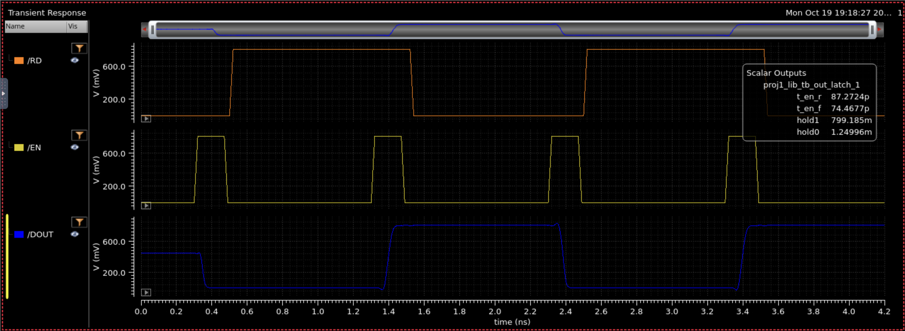

# out_latch unit test

Testbench `proj1_lib/tb_out_latch`: transient, 0 to 4.2 ns, nominal corner, 27 C.

## Setup

| Item | Value |
|---|---|
| VDD (V0) | 0.8 V DC |
| Load on DOUT (`cdout`) | 1 fF |
| RD source (V1) | pulse, 0 to 0.8 V |
| EN source (V2) | pulse, 0 to 0.8 V, period 1 ns, delay 300 ps, rise/fall 20 ps, width `pw_en` = 150 ps |
| Pass specs | `hold1` > 0.72 V, `hold0` < 0.08 V |

Sequence: EN pulses at 0.3, 1.3, 2.3 and 3.3 ns. RD is low at the first pulse (latch captures 0), rises at about 0.5 ns while EN is low (DOUT must hold 0), is high at the second EN pulse (captures 1), then falls at about 1.5 ns while EN is low (DOUT must hold 1), and repeats.

## Results

| Output | Value | Meaning |
|---|---|---|
| t_en_r | 87 ps | EN rising to DOUT rising: the latch captures a 1 |
| t_en_f | 74 ps | EN rising to DOUT falling: the latch captures a 0 |
| hold1 | 0.799 V | DOUT holds 1 while RD falls (pass) |
| hold0 | 1.2 mV | DOUT holds 0 while RD rises (pass) |

Unrounded values from the run: `t_en_r` 87.27 ps, `t_en_f` 74.47 ps, `hold1` 799.185 mV, `hold0` 1.250 mV. Table values are rounded to two significant figures.

## Waveform

DOUT is written only while EN is high and holds its value while RD toggles with EN low. Before the first EN pulse DOUT sits near 450 mV, the unwritten start-up state.

## Related files

- Schematic: `media/out_latch/out_latch_schematic.png`
- Testbench: `media/out_latch/tb_out_latch_schematic.png`
- ADE outputs for this run (current windows): `media/out_latch/out_latch_ade_outputs_en300p.png`
- ADE setup (earlier run, old windows): `media/out_latch/out_latch_ade_setup.png`
- EN source properties: `media/out_latch/out_latch_en_source_props.png`

## Notes for the report

- All devices are minimum size (l = 18n, nfin = 2). The load is a stand-in 1 fF; rerun with the extracted load for Part 2.
- Measurement windows for this run (from the ADE outputs): `t_en_r` over 1.2-2.0 ns, `t_en_f` over 2.2-3.0 ns, `hold1` = ymin of DOUT over 1.5-2.29 ns, `hold0` = ymax of DOUT over 2.5-3.29 ns. Delays are measured at the 0.4 V crossing of DOUT against the EN crossing.
- The earlier ADE setup screenshot (`out_latch_ade_setup.png`) is from before the EN delay changed to 300 ps and uses different windows (hold1 1.1-1.79 ns, hold0 2.1-2.79 ns). Do not cite it for these results.
