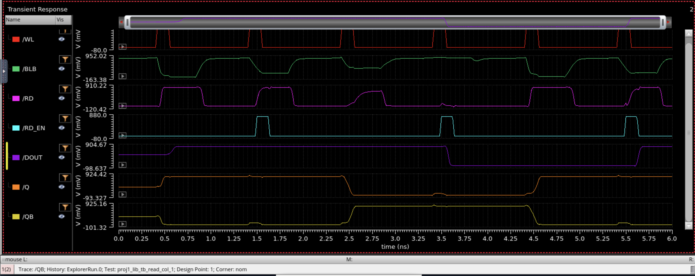
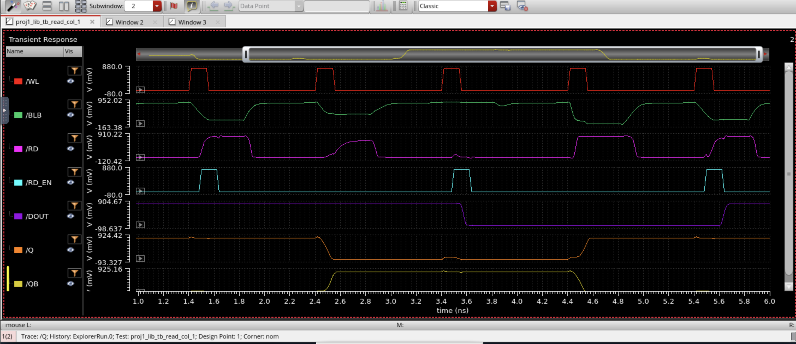
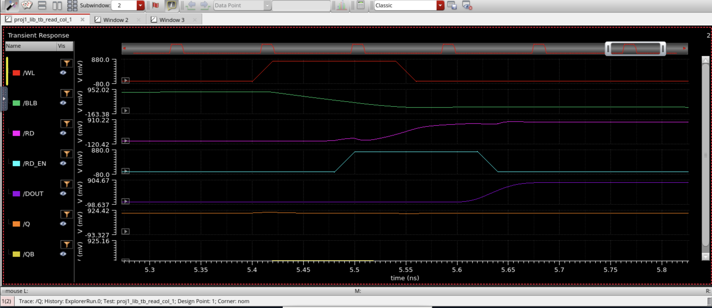

# read_col unit test (2.3)

Testbench `proj1_lib/tb_read_col`: transient, 0 to 6 ns, nominal corner, 27 C. VDD = 0.8 V, `CBL` = 3.5 fF (stand-in bitline load), `cdout` = 1 fF, `pw_w1` = 120p. Swept `rd_dly` (RD_EN delay, 1.48n to 1.68n in 40p steps) and `pw_rden` (RD_EN pulse width, 40p, 80p, 120p, 160p), 24 points. Full data: `read_col_sweep.csv` (all outputs, all points).

Sequence per run: write 1, read, write 0, read, write 1, read. Specs: `dout_c2`, `dout_c6`, `q_rd1`, `dout_g2` > 0.72 V (a stored 1); `dout_c4`, `q_rd0` < 0.08 V (a stored 0).

## Result

Every check passes except `dout_c6` at `pw_rden` = 40p, and that failure is the same at every `rd_dly` (the latch never captures the 1). `dout_g2` (minimum of DOUT over 1.4-2.0 ns) passes at all 24 points at 797-797.5 mV, so DOUT does not glitch even when RD_EN opens early. The reads do not disturb the cell (`q_rd1` 799.7 mV, `q_rd0` about 39 uV at every point).

## Table: access time grid (ps, WL to DOUT)

| rd_dly \ pw_rden | 40p | 80p | 120p | 160p | t_acc0 (read 0) |
|---|---|---|---|---|---|
| 1.48n | fail | 247 | 226 | 226 | 165 |
| 1.52n | fail | 235 | 235 | 235 | 205 |
| 1.56n | fail | 271 | 271 | 271 | 245 |
| 1.60n | fail | 311 | 311 | 311 | 285 |
| 1.64n | fail | 351 | 351 | 351 | 325 |
| 1.68n | fail | 391 | 391 | 391 | 365 |

"fail" at 40p means `dout_c6` fails and `t_acc1` does not evaluate (eval err). Cells show `t_acc1` unless stated.

## How to read it

- Opening RD_EN later only adds delay. From 1.52n on, both access times grow 40 ps for every 40 ps of `rd_dly`, because DOUT waits for the latch to open.
- Width: 120p is the right choice. At 1.48n, 80p passes but is about 22 ps slower (247.4 ps against 225.6 ps): X is only partly charged when the latch closes and the latch has to finish the transition on its own. 120p and 160p give the same 226 ps, so 120p is the shortest width that loses nothing.
- Delay: 1.48n is the best of the delays tested. RD_EN opens about 80 ps after WL, before RD has fully settled, but the long pulse lets the latch wait for RD. `dout_g2` confirms that opening this early causes no glitch. Earlier than 1.48n was not tested.

## Chosen read timing

`rd_dly` = 1.48n, `pw_rden` = 120p, about 140 ps wide at 50% (assuming 20 ps edges). The pulse closes at about 1.64n.

## Table: column read results (WL to DOUT, C_BL = 3.5 fF)

| Measurement | Value |
|---|---|
| BLB reaches the read inverter's switching point (t_blb) | 83 ps |
| RD crosses 0.4 V when the latch isn't loading it (t_rd) | 113 ps |
| DOUT valid, read 0 | 165 ps |
| DOUT valid, read 1 (column access time) | 226 ps |

`t_rd` is 113 ps for `rd_dly` 1.52n and later. At 1.48n it measures 140 ps because the latch is already loading RD.

Single-run check at the chosen point (`rd_dly` = 1.48n, `pw_rden` = 120p), from `media/read_col/read_col_ade_results_1p48n_120p.png`: `t_acc1` 225.6 ps, `t_acc0` 165.1 ps, `t_rd` 140 ps, `t_blb` 83.16 ps, `dout_c2` 799.9 mV, `dout_c4` 9.126 uV, `dout_c6` 799.9 mV, `q_rd1` 799.7 mV, `q_rd0` 38.75 uV, `dout_g2` 796.9 mV. All specs pass and the values match point 3 of `read_col_sweep.csv`.

## Figure: read_col transient at the chosen point

Caption: WL, BLB, RD, RD_EN, DOUT, Q and QB over 6 ns at `rd_dly` = 1.48n, `pw_rden` = 120p. Reads at about 1.5, 3.5 and 5.5 ns; RD_EN opens about 80 ps after each WL rise. DOUT follows the stored data each read (1, 0, 1), including the third read, which fails at `pw_rden` = 40p. Q and QB are undisturbed by the reads.

Cleaner version for the report (best): `../media/read_col/read_col_tran_1p48n_120p_1to6ns_BEST.png`. Same run, plotted from 1.0 to 6.0 ns so the start-up state before the first read is not shown. Cropped to the plot area.

### Zoom on the third read (5.3-5.8 ns)

Stacked, one trace per panel (best for the report): `../media/read_col/read_col_tran_1p48n_120p_zoom_read3_stacked_BEST.png`. Overlay of all signals on one axis, for reference: `../media/read_col/read_col_tran_1p48n_120p_zoom_read3_overlay.png`.

Report caption: "Cycle 6 read of a 1, CBL = 3.5 fF, rd_dly = 1.48n, pw_rden = 120p: BLB crosses the read inverter's 0.376 V switching point 83 ps after WL rises; DOUT is valid 226 ps after WL rises."

From the zoom: WL starts rising at about 5.40 ns, BLB falls through the read inverter's trip point within about 80 ps, RD_EN starts rising at about 5.48 ns (about 80 ps after WL) and closes at about 5.64 ns, and DOUT is high by about 5.67 ns. RD dips briefly when RD_EN opens (the latch loading RD), then recovers while the latch finishes the transition. Q stays at 0.8 V and QB near 0 throughout. Times are read off the plot.

## Does the read limit the wordline?

No. The bitline needs only about 83 ps of wordline time, so a read pulse of about 110 ps at 50% leaves margin. Scaling `t_blb` by +20% C_BL gives roughly 100 ps, which still fits (an estimate, not a simulation). The write's 140 ps pulse still sets WL_EN, so the nfin 6 vs 8 driver decision rests on write speed and T_CLK alone.

## What the controller needs for RD_EN

- Rise about 80 ps after the wordline at the cell. WL_EN is generated before the decoder, so that is about decoder delay + 80 ps after WL_EN.
- Stay high about 140 ps (50% width).
- Pulse in read cycles only.
- Close before precharge pulls BLB back up.

## Open items

- Switching-point value: resolved. The `read_path` schematic in `proj1_lib` currently has PM0 and NM0 both at nfin = 2 (`media/read_path/read_path_schematic_library_view_2to2.png`), i.e. the 2:2 inverter with VM = 0.376 V, so the caption's 0.376 V is correct. The earlier 4:2 version (VM = 0.415 V) is a different design point; make sure the report's read path section says which one `read_col` and the final design use.
- Rerun with the extracted C_BL, and at +20% C_BL, to replace the 83 ps scaling estimate.
- Check the 1.44n and earlier `rd_dly` values to find where early opening stops working.

## Related files

- Data: `results/read_col_sweep.csv`, `results/read_col_dout_c6_sweep.csv` (subset)
- Waveforms at the chosen point: `read_col_tran_1p48n_120p_1to6ns_BEST.png`, `read_col_tran_1p48n_120p_zoom_read3_stacked_BEST.png`, `read_col_tran_1p48n_120p_zoom_read3_overlay.png`, `read_col_tran_1p48n_120p.png` (full 0-6 ns with scalar-free view)
- Results at the chosen point: `media/read_col/read_col_ade_results_1p48n_120p.png`
- Setup: `media/read_col/read_col_ade_setup_dout_g2.png` (current), `read_col_ade_setup_pw_rden.png`, `read_col_ade_setup.png`
- Testbench schematic: `media/read_col/tb_read_col_schematic.png` (instances: precharge, write_driver, sram_6t, read_path, out_latch, with CBL on BL and BLB and `cdout` on DOUT)
- Schematics and waveforms: `media/read_path/`, `media/read_col/`
